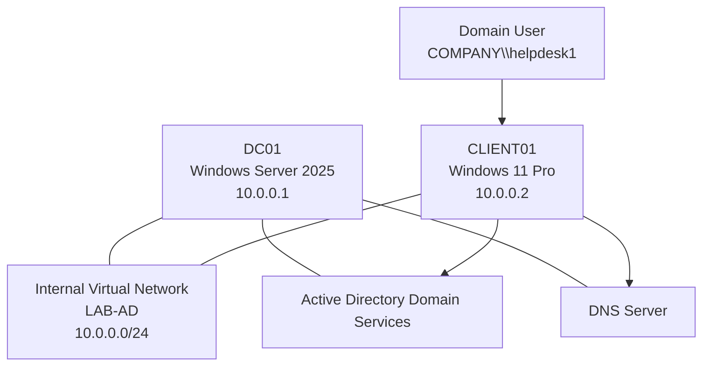

# Windows Server 2025 Active Directory & Help Desk Administration Lab

## Project Overview

This project documents the deployment of a small Windows enterprise-style environment using Windows Server 2025 and Windows 11 Pro.

The purpose of this lab is to develop practical IT support and help desk skills by configuring a Windows Server domain controller, deploying Active Directory Domain Services, configuring DNS, joining a Windows workstation to a domain, and managing domain user accounts.

I designed this environment to simulate common support responsibilities, including:

- Creating and managing Active Directory user accounts.
- Joining Windows workstations to a domain.
- Troubleshooting DNS and domain connectivity.
- Verifying domain authentication.
- Managing organizational units and security groups.

This repository contains the architecture, configuration procedures, PowerShell commands, troubleshooting steps, and evidence collected during the lab.

## Lab Objectives

The main objectives are:

1. Install and configure Windows Server 2025.
2. Configure a static IPv4 address on the domain controller.
3. Install Active Directory Domain Services.
4. Promote the server to a domain controller.
5. Configure DNS for Active Directory.
6. Create a domain user named `helpdesk1`.
7. Create an organizational structure for users and computers.
8. Join a Windows 11 Pro workstation to the domain.
9. Verify domain authentication and DNS resolution.
10. Configure a basic Group Policy Object.
11. Delegate appropriate support permissions.
12. Document troubleshooting and validation results.

## Environment

| Component | Configuration |
|---|---|
| Domain Controller | DC01 |
| Operating System | Windows Server 2025 |
| Domain Controller IP | 10.0.0.1 |
| Subnet Mask | 255.255.255.0 |
| DNS Server | 127.0.0.1 |
| Client Workstation | CLIENT01 |
| Client Operating System | Windows 11 Pro |
| Client IP | 10.0.0.2 |
| Client DNS | 10.0.0.1 |
| Active Directory Domain | company.com |
| NetBIOS Domain | COMPANY |
| Domain User | helpdesk1 |
| Virtual Network | LAB-AD |

The environment uses a private virtual network to isolate the domain infrastructure from the physical network.

## Architecture

## Technologies Used

- Windows Server 2025
- Windows 11 Pro
- Active Directory Domain Services
- DNS Server
- Group Policy Management
- Active Directory Users and Computers
- PowerShell
- Microsoft Management Console
- VirtualBox or another supported hypervisor
- Git and GitHub

## Skills Demonstrated

### Windows Server Administration

- Server installation and configuration.
- Static IPv4 addressing.
- Server role installation.
- Domain controller promotion.
- Server management using PowerShell.

### Active Directory

- Domain creation.
- User account administration.
- Organizational unit management.
- Security group management.
- Computer account management.
- Delegated administration.

### Networking

- IPv4 configuration.
- Subnetting fundamentals.
- DNS client configuration.
- Name resolution troubleshooting.
- Network connectivity testing.
- Domain controller discovery.

### Help Desk Operations

- Domain workstation onboarding.
- User authentication troubleshooting.
- Password reset administration.

## Documentation

| Document | Description |
|---|---|
| [Architecture](docs/01-architecture.md) | Network design and infrastructure components |
| [Build Guide](docs/02-build-guide.md) | Complete server and client deployment procedure |
| [Validation & Testing](docs/03-validation-and-testing.md) | Technical verification commands |
| [Troubleshooting](docs/04-troubleshooting.md) | Common Active Directory and DNS problems |
| [Technical Reflection](docs/05-technical-reflection.md) | Skills learned and areas for improvement |

## Validation

The environment will be considered successfully deployed when:

- DC01 is operating as a domain controller.
- The Active Directory domain is `corp.example.com`.
- DNS resolves the domain controller and client records.
- CLIENT01 is joined to the domain.
- `CORP\helpdesk1` can authenticate to CLIENT01.
- The client can locate the domain controller.
- Group Policy is applied successfully.
- Delegated support permissions work as intended.

The actual validation outputs and screenshots will be stored in the documentation and evidence directory.

## Project Status

This repository documents a practical learning project. Validation results and screenshots are added after the relevant steps have been completed in the lab environment.

## Learning Outcome

This project is intended to strengthen my understanding of how Windows domain environments operate and how IT support teams manage user accounts, workstations, authentication, DNS, and Group Policy.

It also provides a practical foundation for troubleshooting enterprise Windows environments and preparing for entry-level IT support, help desk, desktop support, and junior system administration roles.

## Disclaimer

This is a private, isolated learning environment. It is not intended for production deployment.

No real organization credentials, confidential data, or sensitive information should be stored in this repository.
