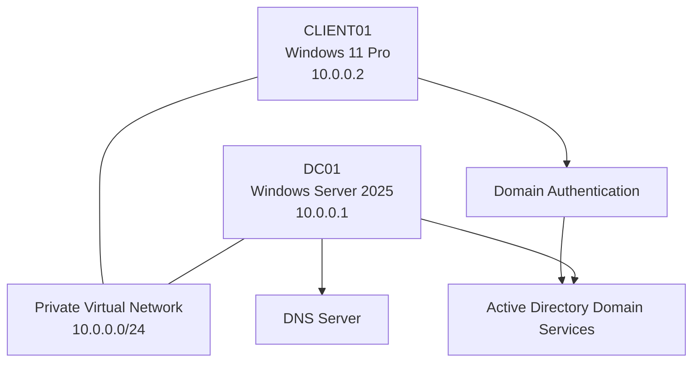

# Windows Server 2025 Active Directory & Help Desk Home Lab

## Project Overview

This project documents the setup and administration of a small Windows domain environment using Windows Server 2025 and a Windows client workstation.

The purpose of this home lab is to develop practical IT support and help desk skills by building a domain environment from the ground up.

The lab includes configuring a Windows Server as a Domain Controller, installing Active Directory Domain Services (AD DS), configuring DNS, creating a domain user account, joining a Windows client to the domain, and validating domain authentication.

I completed this project to gain hands-on experience with the types of tasks an IT Support Technician or Help Desk Analyst may encounter when supporting users in a Windows-based business environment.

## Skills Demonstrated

- Windows Server 2025 installation and configuration
- Active Directory Domain Services administration
- Domain Controller promotion
- DNS configuration and troubleshooting
- Static IP configuration
- Active Directory user account management
- Windows client domain joining
- Domain authentication troubleshooting
- Windows networking fundamentals
- Basic administrative documentation
- Technical troubleshooting and validation

## Lab Environment

| Component | Configuration |
|---|---|
| Server Name | DC01 |
| Server Operating System | Windows Server 2025 |
| Server Role | Domain Controller |
| Domain Name | company.com |
| Server IP Address | 10.0.0.1 |
| Server Subnet Mask | 255.255.255.0 |
| Server DNS | 127.0.0.1 |
| Client Name | CLIENT01 |
| Client Operating System | Windows 11 Pro |
| Client IP Address | 10.0.0.2 |
| Client Subnet Mask | 255.255.255.0 |
| Client DNS | 10.0.0.1 |
| Domain User | helpdesk1 |
| Virtualization Platform | Oracle VirtualBox |

## Network Architecture

The lab uses a private virtual network to allow the Windows Server and Windows client to communicate.

## Project Objectives

The main objectives of this project were:

1. Install and configure Windows Server 2025.
2. Configure a static IPv4 address for the Domain Controller.
3. Install Active Directory Domain Services.
4. Promote DC01 to a Domain Controller.
5. Create the `company.com` Active Directory domain.
6. Configure and validate DNS.
7. Create the `helpdesk1` domain user.
8. Configure CLIENT01 with a static IP address.
9. Join CLIENT01 to the `company.com` domain.
10. Verify that `helpdesk1` can log in to CLIENT01.
11. Troubleshoot and document common domain connectivity issues.

## Implementation Documentation

The project is documented in the following sections:

- [Project Overview](Docs/01-project-overview.md)
- [Lab Build](Docs/02-lab-build.md)
- [Validation and Testing](Docs/03-validation-and-testing.md)
- [Troubleshooting](Docs/04-troubleshooting.md)
- [What I Learned](Docs/05-what-i-learned.md)

## Evidence

Screenshots of the completed configuration are stored in the `docs/evidence/` directory.

The evidence demonstrates:

- Static IP configuration
- Active Directory installation
- Domain Controller configuration
- DNS configuration
- Domain user creation
- Windows client domain joining
- Successful domain user authentication

## Final Result

The completed environment contains a Windows Server 2025 Domain Controller and a Windows 11 client joined to the `company.com` domain.

The client uses DC01 for DNS resolution and domain authentication.

This project helped me understand how a Windows domain environment is configured and how to troubleshoot common issues involving DNS, networking, domain membership, and user authentication.

## Disclaimer

This is a personal educational home lab.

The environment is isolated from production systems and does not contain real company data or credentials.
